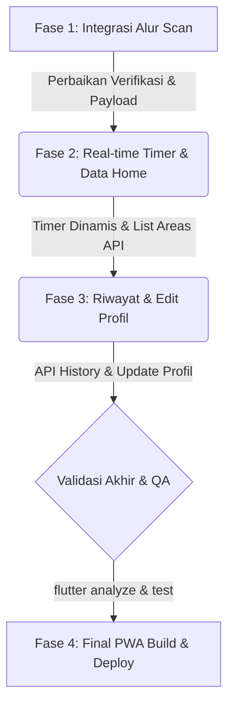

# Progres Project ParkFinder — Mobile App & PWA

## 📊 Estimasi Progress Proyek
- **Selesai (Completed)**: **~60%** (10 dari 17 Halaman Utama telah terintegrasi API)
- **Sisa Pekerjaan (Remaining)**: **~40%** (7 Halaman membutuhkan perbaikan integrasi API, sinkronisasi alur, atau penghapusan data dummy)

---

## 📋 Status Detail Halaman & Fitur

Di bawah ini adalah status integrasi seluruh route dan layar aplikasi:

### 1. Halaman yang Sudah Selesai (✅ 100% Terintegrasi API & Fungsional)
- [x] `/` (SplashScreenPage) — Splash screen beranimasi
- [x] `/welcome` (WelcomePage) — Layar pembuka & tombol Mulai
- [x] `/welcome-transition` (WelcomeTransitionPage) — Transisi animasi ke login
- [x] `/login` (LoginPage) — Login dengan email/password, pembatasan hanya untuk role `user`
- [x] `/register` (RegisterPage) — Form pendaftaran akun baru
- [x] `/welcome-scan` (WelcomeScanPage) — Live camera scanner barcode
- [x] `/booking` (BookingPage) — Daftar area parkir dari API `/areas` dengan fitur pencarian
- [x] `/detail-booking` (DetailBookingPage) — Pemilihan lantai, visualisasi grid slot, reservasi slot (`POST /reservations`)
- [x] `/profil` (ProfilPage) — Profil user aktif (`GET /users/profile`), kendaraan, dan statistik
- [x] `/pengaturan` (PengaturanPage) — Manajemen notifikasi & toggle tema/sound

### 2. Halaman yang Masih Perlu Perbaikan (⚠️ Butuh Sentuhan API / Data Masih Dummy)
- [ ] `/animasi-scan` (AnimasiScanPage) — Data daftar status masih hardcoded (3 item statis)
- [ ] `/halaman-scan` (HalamanScanPage) — Penyelarasan API `POST /access/verify` (backend mengharapkan `qrCode`, mobile saat ini mengirim `ticketId`)
- [ ] `/scan-berhasil` (ScanBerhasilPage) — Kode tiket yang ditampilkan masih hardcoded, belum dinamis sesuai hasil scan kamera
- [ ] `/home` (HomePage) — Daftar parkir terdekat masih dummy (3 item hardcoded)
- [ ] `/status-kendaraan` (StatusKendaraanPage) — Durasi/elapsed timer parkir aktif masih macet/stuck dan tidak bertambah secara real-time
- [ ] `/history` (HistoryPage) — Riwayat reservasi parkir masih berupa data hardcoded (8 item)
- [ ] `/edit-profil` (EditProfilPage) — Form edit profil belum memanggil API untuk menyimpan data (baru sebatas `Navigator.pop`)

---

## 🛠️ Daftar Tugas Sisa Pekerjaan (ToDo List)

Berikut adalah ceklis terperinci untuk menyelesaikan proyek (Target sisa 40%):

### Integrasi Scanner & Verifikasi Tiket
- [ ] **Alur Scanner (`/halaman-scan` & `/welcome-scan`)**:
  - Samakan payload request `POST /access/verify` agar mengirim parameter `{ qrCode: ... }` sesuai API contract.
  - Tangkap data hasil verifikasi (`ticketId` dan `areaName` dari backend) dan kirim sebagai argumen saat navigasi.
- [ ] **Halaman Hasil Scan (`/scan-berhasil`)**:
  - Ganti kode tiket dan area parkir hardcoded dengan parameter dinamis hasil scan yang dikirimkan dari halaman sebelumnya.

### Halaman Dashboard & Status Aktif
- [ ] **Daftar Parkir di Home (`/home`)**:
  - Ganti data dummy list parkir terdekat dengan memanggil API `GET /areas`.
- [ ] **Timer Parkir Aktif (`/status-kendaraan`)**:
  - Buat logic pembaruan timer (misalnya menggunakan `Timer.periodic`) untuk melakukan increment durasi parkir secara berkala (real-time).

### Profil, Riwayat, & Fitur Lainnya
- [ ] **Penyimpanan Profil (`/edit-profil`)**:
  - Hubungkan form edit profile ke API untuk meng-update nama, nomor telepon, atau plat nomor default pengguna.
- [ ] **Riwayat Reservasi (`/history`)**:
  - Tarik data riwayat booking nyata dari API reservasi user untuk menggantikan 8 data dummy.

---

## 🚀 Roadmap Alur Pengembangan ke Depan

Untuk menyelesaikan proyek secara efisien, alur pengerjaan direkomendasikan berjalan dalam urutan fase berikut:

1. **Fase 1: Perbaikan Alur Scan & Verifikasi Tiket (Paling Kritis)**  
   Menyelesaikan masalah parser scanner agar tiket yang di-scan kamera menghasilkan ticket ID yang sah untuk digunakan pada saat booking slot.
2. **Fase 2: Sinkronisasi Real-time Dashboard**  
   Menghubungkan `/home` dengan daftar area riil dan mengaktifkan fungsionalitas timer pada halaman status kendaraan aktif.
3. **Fase 3: Pembersihan Sisa Data Dummy (Profil & Riwayat)**  
   Mengganti sisa-sisa data dummy di `/history` dan menghubungkan form `/edit-profil` dengan endpoint update database.
4. **Fase 4: Finalisasi PWA & Build**  
   Melakukan audit kode akhir (`flutter analyze` dan `flutter test`), kemudian melakukan kompilasi build PWA akhir ke direktori `pwa/` untuk siap dideploy.
