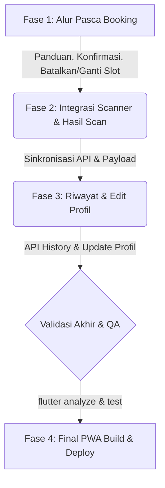

# Progres Project ParkFinder — Mobile App & PWA

## 📊 Estimasi Progress Proyek
- **Selesai (Completed)**: **~65%** (12 dari 18 Bagian/Halaman Utama telah terintegrasi API & Fungsional)
- **Sisa Pekerjaan (Remaining)**: **~35%** (6 Bagian/Halaman membutuhkan perbaikan integrasi API, penambahan alur pasca booking, atau pembersihan data dummy)

---

## 📋 Status Detail Halaman & Fitur

Di bawah ini adalah status integrasi seluruh route dan layar aplikasi:

### 1. Halaman yang Sudah Selesai (✅ 100% Terintegrasi API & Fungsional)
- [x] `/` (SplashScreenPage) — Splash screen beranimasi
- [x] `/welcome` (WelcomePage) — Layar pembuka & tombol Mulai
- [x] `/welcome-transition` (WelcomeTransitionPage) — Transisi animasi ke login
- [x] `/login` (LoginPage) — Login dengan email/password, pembatasan hanya untuk role `user`
- [x] `/register` (RegisterPage) — Form pendaftaran akun baru
- [x] `/welcome-scan` (WelcomeScanPage) — Live camera scanner barcode
- [x] `/booking` (BookingPage) — Daftar area parkir dari API `/areas` dengan fitur pencarian
- [x] `/detail-booking` (DetailBookingPage) — Pemilihan lantai, visualisasi grid slot, reservasi slot (`POST /reservations`)
- [x] `/profil` (ProfilPage) — Profil user aktif (`GET /users/profile`), kendaraan, dan statistik
- [x] `/pengaturan` (PengaturanPage) — Manajemen notifikasi & toggle tema/sound
- [x] `/home` (HomePage) — Daftar parkir terdekat sudah terintegrasi dinamis dari API `GET /areas`
- [x] `/status-kendaraan` (StatusKendaraanPage) — Durasi/elapsed timer parkir aktif berjalan bertambah secara real-time (sinkron menggunakan timestamp `claimedAt` atau waktu reservasi)

### 2. Halaman & Alur yang Masih Perlu Perbaikan / Pengembangan (⚠️ Belum Selesai)
- [ ] `/animasi-scan` (AnimasiScanPage) — Data daftar status masih hardcoded (3 item statis)
- [ ] `/halaman-scan` (HalamanScanPage) — Penyelarasan API `POST /access/verify` (backend mengharapkan `qrCode`, mobile saat ini mengirim `ticketId`)
- [ ] `/scan-berhasil` (ScanBerhasilPage) — Kode tiket yang ditampilkan masih hardcoded, belum dinamis sesuai hasil scan kamera
- [ ] `/history` (HistoryPage) — Riwayat reservasi parkir masih berupa data hardcoded (8 item)
- [ ] `/edit-profil` (EditProfilPage) — Form edit profil belum memanggil API untuk menyimpan data (baru sebatas `Navigator.pop`)
- [ ] **Alur Pasca Booking (Fungsionalitas & UI)** — Fitur setelah reservasi berhasil dibuat hingga pengguna sampai di lokasi slot (lihat `referensi alur/`)

---

## 🛠️ Daftar Tugas Sisa Pekerjaan (ToDo List)

Berikut adalah ceklis terperinci untuk menyelesaikan proyek (Target sisa 35%):

### 🚨 Alur Pasca Booking (Terbaru - TASK 0044)
- [ ] **Panduan Menuju Slot Parkir**: Menampilkan rute/petunjuk arah visual dari gerbang masuk menuju slot yang di-booking.
- [ ] **Tombol "Saya Sudah Sampai"**: Tombol konfirmasi ketika pengguna telah menempati slot parkir untuk mengaktifkan sesi parkir secara penuh.
- [ ] **Notifikasi Keberhasilan**: Tampilkan pesan/banner pemberitahuan *"Selamat, Anda sudah berhasil mengaktifkan slot parkir xxx"* setelah menekan tombol sampai.
- [ ] **Pilihan "Ganti Slot"**: Sediakan tombol/opsi mengganti slot di bawah tombol "Saya Sudah Sampai".
- [ ] **Pilihan "Batalkan Reservasi"**: Sediakan opsi pembatalan booking sebelum pengguna menekan tombol sudah sampai.

### Integrasi Scanner & Verifikasi Tiket
- [ ] **Alur Scanner (`/halaman-scan` & `/welcome-scan`)**:
  - Samakan payload request `POST /access/verify` agar mengirim parameter `{ qrCode: ... }` sesuai API contract.
  - Tangkap data hasil verifikasi (`ticketId` dan `areaName` dari backend) dan kirim sebagai argumen saat navigasi.
- [ ] **Halaman Hasil Scan (`/scan-berhasil`)**:
  - Ganti kode tiket dan area parkir hardcoded dengan parameter dinamis hasil scan yang dikirimkan dari halaman sebelumnya.

### Profil, Riwayat, & Fitur Lainnya
- [ ] **Penyimpanan Profil (`/edit-profil`)**:
  - Hubungkan form edit profile ke API untuk meng-update nama, nomor telepon, atau plat nomor default pengguna.
- [ ] **Riwayat Reservasi (`/history`)**:
  - Tarik data riwayat booking nyata dari API reservasi user untuk menggantikan 8 data dummy.

---

## 🚀 Roadmap Alur Pengembangan ke Depan

Untuk menyelesaikan proyek secara efisien, alur pengerjaan direkomendasikan berjalan dalam urutan fase berikut:

1. **Fase 1: Implementasi Alur Pasca Booking (TASK 0044 - Prioritas Baru)**  
   Menambahkan panduan navigasi slot, tombol kedatangan, notifikasi sukses aktif, fitur ganti slot, dan pembatalan reservasi.
2. **Fase 2: Perbaikan Alur Scan & Verifikasi Tiket**  
   Menyelesaikan masalah parser scanner agar tiket yang di-scan kamera menghasilkan ticket ID yang sah untuk digunakan pada saat booking slot.
3. **Fase 3: Pembersihan Sisa Data Dummy (Profil & Riwayat)**  
   Mengganti sisa-sisa data dummy di `/history` dan menghubungkan form `/edit-profil` dengan endpoint update database.
4. **Fase 4: Finalisasi PWA & Build**  
   Melakukan audit kode akhir (`flutter analyze` dan `flutter test`), kemudian melakukan kompilasi build PWA akhir ke direktori `pwa/` untuk siap dideploy.
