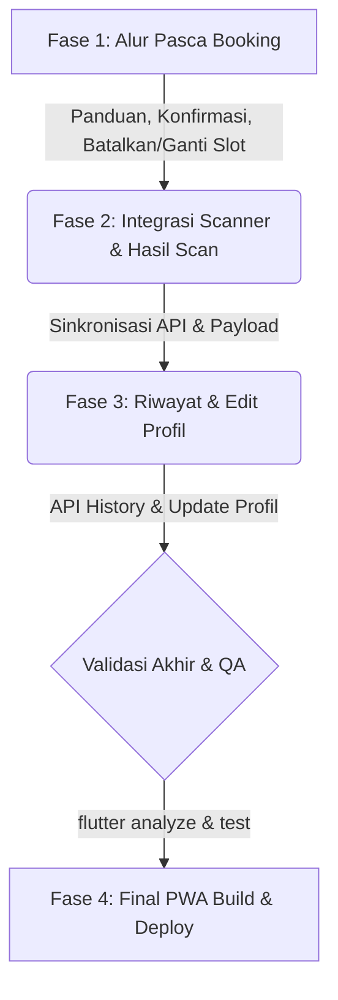

# Progres Project ParkFinder — Mobile App & PWA

## 📊 Estimasi Progress Proyek
- **Selesai (Completed)**: **~80%** (Refactor arsitektur selesai + 13 dari 18 halaman terintegrasi API)
- **Sisa Pekerjaan (Remaining)**: **~20%** (5 halaman masih butuh perbaikan data dummy/API)

---

## 🏗️ Refactor Arsitektur — SELESAI (TASK REFACTOR-01)

**Status**: ✅ Selesai — `flutter analyze` 0 errors, 0 warnings/infos related to unused files.
Seluruh folder dan file lama yang sudah tidak digunakan telah **berhasil dihapus** dengan aman tanpa merusak kompilasi aplikasi.

### Yang Berubah:
| Komponen | Sebelum | Sesudah |
|----------|---------|---------|
| State Management | `setState()` everywhere | **Provider** (`ChangeNotifier`) per feature |
| Model & Service | Model di dalam file service | Model dipisah ke `models/` folder |
| Shared Widgets | `features/public_widget/` | `shared/widgets/` + barrel export |
| Token Storage | `ApiService.setToken/clearToken` | `TokenStorage` (SRP) |
| TicketData | Definisi duplikat di 2 file | Satu definisi di `scan/models/ticket_data.dart` |
| Routing | `app/app_routes.dart` | `core/routes/app_routes.dart` + `app_router.dart` |
| Config | Hard-code URL | `core/config/app_config.dart` |
| Constants | Magic strings | `core/constants/app_constants.dart` |

### File Baru Dibuat:
- `core/config/app_config.dart` — centralized base URL
- `core/constants/app_constants.dart` — SharedPreferences keys & constants
- `core/storage/token_storage.dart` — JWT token storage (SRP)
- `core/routes/app_routes.dart` — route constants
- `core/routes/app_router.dart` — route generator
- `core/api/api_client.dart` — barrel export ApiClient
- `features/auth/` — gabungan login + register + AuthProvider
- `features/parking/models/parking_area.dart` — model terpisah
- `features/parking/models/parking_slot.dart` — model terpisah
- `features/parking/models/reservation_result.dart` — model terpisah
- `features/parking/services/booking_service.dart` — service bersih
- `features/parking/providers/parking_provider.dart` — Provider
- `features/scan/models/ticket_data.dart` — model tunggal (eliminasi duplikasi)
- `features/scan/services/scan_service.dart` — service bersih
- `features/scan/providers/scan_provider.dart` — Provider
- `features/profile/models/profile_data.dart` — model terpisah
- `features/profile/models/vehicle.dart` — model terpisah
- `features/profile/services/profile_service.dart` — service bersih
- `features/profile/providers/profile_provider.dart` — Provider
- `features/home/providers/home_provider.dart` — Provider
- `features/history/providers/history_provider.dart` — Provider
- `shared/widgets/primary_button.dart` — reusable button
- `shared/widgets/loading_widget.dart` — reusable loading
- `shared/widgets/empty_error_state.dart` — EmptyState + ErrorState
- `shared/widgets/confirmation_dialog.dart` — reusable dialog
- `shared/widgets/shared_widgets.dart` — barrel export

### Provider yang Terdaftar di main.dart:
- `AuthProvider` — login, register, logout
- `HomeProvider` — daftar area & reservasi aktif
- `ParkingProvider` — booking, slot, reservasi ops
- `ScanProvider` — verifikasi QR tiket
- `HistoryProvider` — riwayat reservasi
- `ProfileProvider` — profil & kendaraan

---

## 📋 Status Detail Halaman & Fitur

Di bawah ini adalah status integrasi seluruh route dan layar aplikasi:

### 1. Halaman yang Sudah Selesai (✅ 100% Terintegrasi API & Fungsional)
- [x] `/` (SplashScreenPage) — Splash screen beranimasi
- [x] `/welcome` (WelcomePage) — Layar pembuka & tombol Mulai
- [x] `/welcome-transition` (WelcomeTransitionPage) — Transisi animasi ke login
- [x] `/login` (LoginPage) — Login dengan email/password, pembatasan hanya untuk role `user`
- [x] `/register` (RegisterPage) — Form pendaftaran akun baru
- [x] `/welcome-scan` (WelcomeScanPage) — Live camera scanner barcode
- [x] `/booking` (BookingPage) — Daftar area parkir dari API `/areas` dengan fitur pencarian
- [x] `/detail-booking` (DetailBookingPage) — Pemilihan lantai, visualisasi grid slot, reservasi slot (`POST /reservations`)
- [x] `/profil` (ProfilPage) — Profil user aktif (`GET /users/profile`), kendaraan, dan statistik
- [x] `/pengaturan` (PengaturanPage) — Manajemen notifikasi & toggle tema/sound
- [x] `/home` (HomePage) — Daftar parkir terdekat sudah terintegrasi dinamis dari API `GET /areas`
- [x] `/status-kendaraan` (StatusKendaraanPage) — Durasi/elapsed timer parkir aktif berjalan bertambah secara real-time (sinkron menggunakan timestamp `claimedAt` atau waktu reservasi)
- [x] **Alur Pasca Booking (Fungsionalitas & UI)** — Fitur setelah reservasi berhasil dibuat hingga pengguna sampai di lokasi slot (lihat `referensi alur/`) - **SELESAI (TASK 0044)**
- [x] **Perbaikan Bug Arrive Method (PATCH)** — Mengatasi FormatException saat menekan tombol "Saya Sudah Sampai" - **SELESAI (TASK 0045)**
- [x] **Perbaikan Bug & UI Selesai Parkir (PATCH)** — Mengubah method complete menjadi PATCH dan merubah label tombol menjadi "Selesai Parkir" - **SELESAI (TASK 0046)**

### 2. Halaman & Alur yang Masih Perlu Perbaikan / Pengembangan (⚠️ Belum Selesai)
- [ ] `/animasi-scan` (AnimasiScanPage) — Data daftar status masih hardcoded (3 item statis)
- [ ] `/halaman-scan` (HalamanScanPage) — Penyelarasan API `POST /access/verify` (backend mengharapkan `qrCode`, mobile saat ini mengirim `ticketId`)
- [ ] `/scan-berhasil` (ScanBerhasilPage) — Kode tiket yang ditampilkan masih hardcoded, belum dinamis sesuai hasil scan kamera
- [ ] `/history` (HistoryPage) — Riwayat reservasi parkir masih berupa data hardcoded (8 item)
- [ ] `/edit-profil` (EditProfilPage) — Form edit profil belum memanggil API untuk menyimpan data (baru sebatas `Navigator.pop`)

---

## 🛠️ Daftar Tugas Sisa Pekerjaan (ToDo List)

Berikut adalah ceklis terperinci untuk menyelesaikan proyek (Target sisa 25%):

### 🚨 Alur Pasca Booking (Terbaru - TASK 0044)
- [x] **Panduan Menuju Slot Parkir**: Menampilkan rute/petunjuk arah visual dari gerbang masuk menuju slot yang di-booking.
- [x] **Tombol "Saya Sudah Sampai"**: Tombol konfirmasi ketika pengguna telah menempati slot parkir untuk mengaktifkan sesi parkir secara penuh.
- [x] **Notifikasi Keberhasilan**: Tampilkan pesan/banner pemberitahuan *"Selamat, Anda sudah berhasil mengaktifkan slot parkir xxx"* setelah menekan tombol sampai.
- [x] **Pilihan "Ganti Slot"**: Sediakan tombol/opsi mengganti slot di bawah tombol "Saya Sudah Sampai".
- [x] **Pilihan "Batalkan Reservasi"**: Sediakan opsi pembatalan booking sebelum pengguna menekan tombol sudah sampai.

### 🚨 Perbaikan Bug (Terbaru - TASK 0045)
- [x] **Fix Method Arrive (Saya Sudah Sampai)**: Ubah method HTTP dari `POST` menjadi `PATCH` pada endpoint `/reservations/{reservationId}/arrive` untuk mengatasi FormatException akibat response HTML 404.

### 🚨 Perbaikan Bug & UI (Terbaru - TASK 0046)
- [x] **Fix Method Complete (Keluar Parkir)**: Ubah method HTTP dari `POST` menjadi `PATCH` pada endpoint `/reservations/{reservationId}/complete` untuk mengatasi error 404.
- [x] **Tombol Selesai Parkir**: Tambahkan/sesuaikan tombol "Selesai Parkir" atau "Parkir Selesai" pada `StatusKendaraanPage` saat status kendaraan aktif/arrived.

### Integrasi Scanner & Verifikasi Tiket
- [ ] **Alur Scanner (`/halaman-scan` & `/welcome-scan`)**:
  - Samakan payload request `POST /access/verify` agar mengirim parameter `{ qrCode: ... }` sesuai API contract.
  - Tangkap data hasil verifikasi (`ticketId` dan `areaName` dari backend) dan kirim sebagai argumen saat navigasi.
- [ ] **Halaman Hasil Scan (`/scan-berhasil`)**:
  - Ganti kode tiket dan area parkir hardcoded dengan parameter dinamis hasil scan yang dikirimkan dari halaman sebelumnya.

### Profil, Riwayat, & Fitur Lainnya
- [ ] **Penyimpanan Profil (`/edit-profil`)**:
  - Hubungkan form edit profile ke API untuk meng-update nama, nomor telepon, atau plat nomor default pengguna.
- [ ] **Riwayat Reservasi (`/history`)**:
  - Tarik data riwayat booking nyata dari API reservasi user untuk menggantikan 8 data dummy.

---

## 🔗 Dokumentasi API Backend (Referensi Alur Booking)

1. **Reservasi Booking (POST)**
   - **Endpoint**: `/reservations`
   - **Payload**:
     ```json
     {
         "ticketId": "v1woiGoTjIxd4whmd2gt",
         "slotId": "3QHzrYhMBlPtpJ0xklOe"
     }
     ```

2. **Konfirmasi Kedatangan/Arrive (PATCH)**
   - **Endpoint**: `/reservations/{reservationId}/arrive`

3. **Selesai Parkir/Complete (PATCH)**
   - **Endpoint**: `/reservations/{reservationId}/complete`

4. **Dapatkan Riwayat Reservasi User (GET)**
   - **Endpoint**: `/users/{userId}/reservations`

5. **Dapatkan Detail Reservasi by ID (GET)**
   - **Endpoint**: `/reservations/{reservationId}`

6. **Batalkan Reservasi (POST)**
   - **Endpoint**: `/reservations/{reservationId}/cancel`

7. **Ganti/Swap Slot (POST/PATCH)**
   - **Endpoint**: `/reservations/{reservationId}/swap`
   - **Payload**:
     ```json
     {
         "newSlotId": "hxEQBIQsLPFHxXdelqU8"
     }
     ```

---

## 🚀 Roadmap Alur Pengembangan ke Depan

Untuk menyelesaikan proyek secara efisien, alur pengerjaan direkomendasikan berjalan dalam urutan fase berikut:



1. **Fase 1: Implementasi Alur Pasca Booking (TASK 0044 - SELESAI)**  
   Menambahkan panduan navigasi slot, tombol kedatangan, notifikasi sukses aktif, fitur ganti slot, dan pembatalan reservasi.
2. **Fase 2: Perbaikan Alur Scan & Verifikasi Tiket**  
   Menyelesaikan masalah parser scanner agar tiket yang di-scan kamera menghasilkan ticket ID yang sah untuk digunakan pada saat booking slot.
3. **Fase 3: Pembersihan Sisa Data Dummy (Profil & Riwayat)**  
   Mengganti sisa-sisa data dummy di `/history` dan menghubungkan form `/edit-profil` dengan endpoint update database.
4. **Fase 4: Finalisasi PWA & Build**  
   Melakukan audit kode akhir (`flutter analyze` dan `flutter test`), kemudian melakukan kompilasi build PWA akhir ke direktori `pwa/` untuk siap dideploy.
